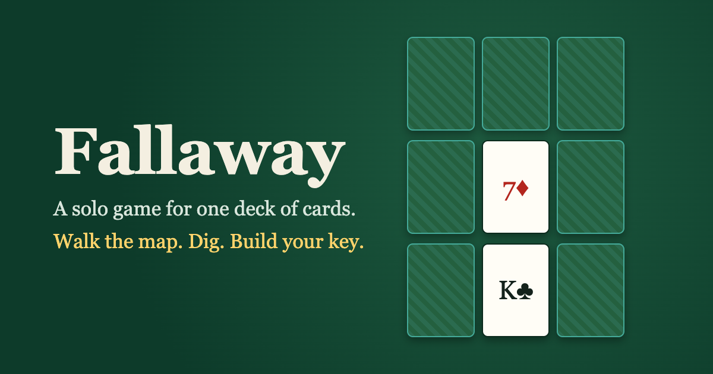

# Fallaway

**A free solo card game for one standard 52-card deck.** 1 player · about 15 minutes · no special cards, no printing.

**[▶ Play Fallaway in your browser](https://ifaka.github.io/fallaway/)** · [Rules](RULES.md) · [Example game](RUN_EXAMPLE.md) · [Design notes](DESIGN_NOTES.md)

You are an explorer crossing a land bigger than you can see. Walk a sliding 3×3 map of cards while the land behind you falls away, dig regions for supplies while hostile cards fight back, claim 4 key cards of one suit in a row, then reach the finish card.

Every card in your hand is three things at once:
- **Food.** Every step you take eats one card.
- **A weapon.** A higher card of a suit beats the hostile cards of that suit.
- **A key.** Its rank opens the key card of the same rank.

Spending a card for one job means giving up the other two. That trade-off is the game.

## Ways to play

- **On screen**: the app deals an animated game, with hints, a win record and a daily deal (the same deal for everyone that day).
- **With your real deck**: shuffle a physical deck and the app walks you through every step. You enter the cards you turn over, and it keeps track of the piles, your hand and the map.
- **Rules only**: [RULES.md](RULES.md) is a complete rulebook for playing at a table, no screen needed.

## Skill and luck

There are no difficulty levels: everyone plays the same game. A careful player wins about 54 games in 100, and a beginner about 1 in 3. Skill decides how often you win, but the deck decides any single game, like poker. Every rule was tested with bots over thousands of games; the numbers are in [DESIGN_NOTES.md](DESIGN_NOTES.md).

## Repository

- **`RULES.md`**: the rulebook (play with a real deck).
- **`app/`**: the web app (Vite, React, TypeScript). Play on screen, or play your real deck with step-by-step guidance (`app/README.md`).
- **`core/engine.ts`**: the rules engine, the only implementation of the rules. The app and the simulator both play it.
- **`sim/sim.ts`**: simulator with bots: skill ladder, per-decision skill, fairness, luck (`node sim/sim.ts report`).
- **`DESIGN_NOTES.md`**: why the rules are what they are, with the numbers; history of earlier versions.
- **`RUN_EXAMPLE.md`**: a full narrated game.
- **`AGENTS.md`**: how to work on the code (for contributors and AI coding agents).
- `archive/`: earlier simulators, kept so old results stay reproducible: v1–v3 rules, and `sim-v4.mjs` with every rule variant tested for v4.

Run it locally: `cd app && npm install && npm run dev`, then open http://localhost:5199.
